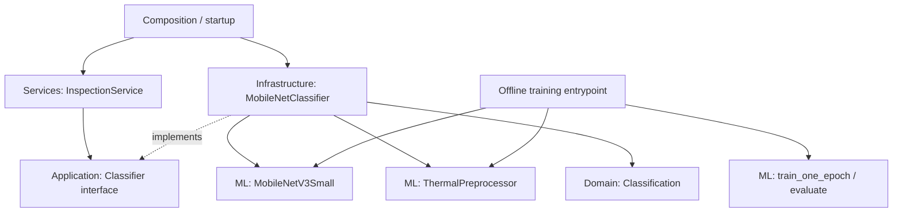

# MobileNetV3 guide for this project

This guide explains the code currently in `src/ml`, why it is structured that way, how to train it, and how to connect it to your application later. It is an implementation guide, not a claim that a PV model has already been trained.

The code walkthrough was checked against this workspace. Network shapes and parameter counts were measured locally with PyTorch 2.8.0+cu128 and torchvision 0.23.0+cu128, using random weights and CPU execution. Those are the versions observed during review, not a requirement to use CUDA. Online documentation may describe newer versions.

Examples labeled “proposed” below are code for you to implement; they do not already exist as executable files. This documentation task adds only this guide.

## Contents

1. [What exists and what remains](#1-what-exists-and-what-remains)
2. [Layer ownership and dependency direction](#2-layer-ownership-and-dependency-direction)
3. [File map and reading order](#3-file-map-and-reading-order)
4. [Network construction in mobilenet.py](#4-network-construction-in-mobilenetpy)
5. [The forward pass and actual tensor shapes](#5-the-forward-pass-and-actual-tensor-shapes)
6. [Feature freezing and training mode](#6-feature-freezing-and-training-mode)
7. [Preprocessing in preprocessing.py](#7-preprocessing-in-preprocessingpy)
8. [One training epoch](#8-one-training-epoch)
9. [Evaluation and metric interpretation](#9-evaluation-and-metric-interpretation)
10. [Dataset inspection and split design](#10-dataset-inspection-and-split-design)
11. [Proposed Dataset and DataLoader code](#11-proposed-dataset-and-dataloader-code)
12. [Proposed training entrypoint](#12-proposed-training-entrypoint)
13. [How to improve the baseline](#13-how-to-improve-the-baseline)
14. [Checkpoint contents and reloading](#14-checkpoint-contents-and-reloading)
15. [Proposed infrastructure adapter](#15-proposed-infrastructure-adapter)
16. [Application wiring and runtime sequence](#16-application-wiring-and-runtime-sequence)
17. [Common errors and debugging](#17-common-errors-and-debugging)
18. [Ordered implementation checklist](#18-ordered-implementation-checklist)

## 1. What exists and what remains

The current ML package supplies four pieces:

- A PyTorch network whose final output size matches your class count.
- A deterministic Pillow-to-tensor preprocessor.
- A function that performs one training epoch.
- A function that evaluates labeled batches.

It also contains usage documentation and a local dependency list.

It does not currently include a downloaded dataset, a Dataset class, split files, a training command, trained PV weights, an infrastructure Classifier implementation, or a deployment endpoint. Training does not require MySQL, GPS coordinates, ImageService, or InspectionService. It requires labeled images and an experiment setup.

The ML task currently assumed is **single-label classification of an already-cropped module image**. One image has one class index. The network does not locate panels in a full UAV frame, segment faults, identify a physical asset, or measure temperature from raw radiometric sensor values.

Even with ImageNet weights, the new PV output layer starts untrained. A forward pass that returns 12 numbers is evidence that the network runs; it is not evidence that those numbers describe PV defects accurately.

## 2. Layer ownership and dependency direction

Your runtime dependency structure should be:



The dashed implementation edge is a dependency relationship. At runtime, the service's interface reference points to the concrete adapter object supplied during startup.

| Component | Owns | May depend on |
| --- | --- | --- |
| Domain `Classification` | Fault label and confidence representation | Domain model dependencies |
| Application `Classifier` | Contract: bytes in, Classification out | Domain |
| InspectionService | Read saved image, map asset, classify, persist inspection | Application ports and domain |
| Infrastructure MobileNetClassifier, proposed | Decode bytes, load model artifact, run inference, map outputs to domain result | Application port, domain, ML package, Pillow/PyTorch |
| ML package | Network operations, tensor preprocessing, training/evaluation math | PyTorch, torchvision, Pillow |
| Offline training entrypoint, proposed | Dataset paths, splits, optimizer, epochs, artifact output | ML package and dataset tooling |
| Composition/startup, proposed | Construct implementations and inject dependencies | All components required for wiring |

`src/ml` is an implementation package using framework libraries. It is allowed to import PyTorch directly. Application use cases continue to depend on abstractions.

The ML network does not subclass the application `Classifier`: the signatures differ. A network consumes tensors and returns logits; the application contract consumes bytes and returns `Classification`. The infrastructure adapter bridges them.

There is no need for a new ClassificationService merely to call the network. InspectionService already owns the inspection use case.

No new schema was needed for the current ML constructors. Their arguments are implementation settings. If you introduce shared schema models later, follow your chosen schema location and keep framework objects such as tensors, optimizers, and weight enums out of business-result models.

## 3. File map and reading order

Read the existing files in this order:

| Existing file | Purpose |
| --- | --- |
| [mobilenet.py](../src/ml/mobilenet.py) | Defines the network and exposes its forward pass |
| [preprocessing.py](../src/ml/preprocessing.py) | Converts an accepted Pillow image to a normalized tensor |
| [training.py](../src/ml/training.py) | Updates parameters for one epoch and evaluates labeled batches |
| [__init__.py](../src/ml/__init__.py) | Exports the public ML API |
| [requirements.txt](../src/ml/requirements.txt) | Lists torch, torchvision, and pillow |
| [README.md](../src/ml/README.md) | Short usage reference |

The exported API is:

```python
from src.ml import (
    MobileNetV3Small,
    ThermalPreprocessor,
    train_one_epoch,
    evaluate,
)
```

Importing the package imports its dependencies, but it does not construct a network, download weights, train, or connect to MySQL.

Run commands from the repository root so the `src` imports resolve:

```bash
python -m pip install -r src/ml/requirements.txt
python -c "from src.ml import MobileNetV3Small; print(MobileNetV3Small(weights=None))"
```

Install a compatible torch/torchvision pair for your actual CPU or CUDA environment. The dependency file is currently unpinned; record the exact working versions for a reproducible experiment. This guide does not install packages or alter your environment.

## 4. Network construction in mobilenet.py

### 4.1 What MobileNetV3Small is

`MobileNetV3Small` subclasses `torch.nn.Module`. This gives it parameter registration, child-module registration, training/evaluation modes, device movement, and state dictionaries.

The wrapper uses torchvision's implementation. It keeps its feature extractor, pooling, and classifier body, then replaces the final classifier layer. The official builder supports explicit ImageNet weight selection. [Torchvision MobileNetV3-Small API](https://docs.pytorch.org/vision/stable/models/generated/torchvision.models.mobilenet_v3_small.html)

A model is instantiated once:

```python
model = MobileNetV3Small(
    num_classes=12,
    dropout=0.2,
    freeze_features=False,
)
```

The default `weights` argument requests `IMAGENET1K_V1`. Construction can download that artifact if it is not cached. Passing `weights=None` constructs the same architecture with random initialization.

### 4.2 Every constructor argument

| Argument | Current default | Meaning | When to change it |
| --- | --- | --- | --- |
| `num_classes` | 12 | Number of mutually exclusive class outputs | Use the length of your saved label list |
| `weights` | ImageNet V1 | Initial values for torchvision layers before replacing the last layer | Use None for offline inspection, a scratch experiment, or loading your saved full state |
| `dropout` | 0.2 | Probability of dropping classifier activations during training | Compare controlled regularization experiments |
| `freeze_features` | False | Whether feature parameters and feature training statistics stay fixed | Useful for an initial classifier-only warmup |

The constructor checks that the class count is at least two and dropout is between zero inclusive and one exclusive. These checks are not a complete configuration schema; callers should supply actual integer class counts.

The `*` in the signature makes the remaining arguments keyword-only:

```python
model = MobileNetV3Small(12, dropout=0.1)
```

This makes experiment settings easier to read and avoids confusing an argument's position.

### 4.3 Why replace only the last Linear

The current construction is conceptually:

```python
backbone = mobilenet_v3_small(weights=weights, dropout=dropout)
features = backbone.features
avgpool = backbone.avgpool
classifier = backbone.classifier
classifier[-1] = nn.Linear(classifier[-1].in_features, num_classes)
```

With ImageNet initialization, all retained compatible parameters start from the pretrained artifact. The replacement output layer starts with fresh PyTorch Linear initialization.

For this unmodified Small architecture the classifier is:

```text
Linear(576 → 1024)
Hardswish
Dropout(p=dropout)
Linear(1024 → num_classes)
```

The first Linear stays pretrained when weights are supplied. The wrapper obtains the final layer's input width from `in_features` so it does not separately hardcode that width when replacing the head.

The wrapper does not expose width multipliers, a one-channel first convolution, or a Large variant. Those would be future architectural changes requiring checkpoint compatibility review. Start by establishing a measurable baseline with the current network.

### 4.4 What the feature extractor does

The feature extractor progressively transforms spatial image patterns into learned feature channels. Its blocks use convolutions, normalization, nonlinearities, and—in selected blocks—channel attention and residual connections.

A depthwise convolution handles spatial filtering per channel; pointwise convolutions mix channels. An inverted residual block expands/interprets a representation internally and projects it to its output channels. Where compatible, the residual connection adds the original input. Squeeze-and-excitation weights channels using information summarized from the feature map.

These operations are already implemented by torchvision. Inspect `print(model.features)` to see the exact active modules rather than recreating them. [Torchvision 0.23 MobileNetV3 implementation](https://docs.pytorch.org/vision/0.23/_modules/torchvision/models/mobilenetv3.html)

This architecture is a reasonable compact baseline, but its suitability for your thermal data must be measured. ImageNet pretraining does not establish which PV anomaly features will transfer.

## 5. The forward pass and actual tensor shapes

The network accepts `[N, 3, H, W]`:

- `N`: batch size.
- `3`: input channels.
- `H`: height.
- `W`: width.

It returns `[N, C]`, with `C = num_classes`.

The current `forward` checks tensor rank and channel count. It does not validate all possible dtype, device, spatial-size, or finite-value errors; the Dataset and training setup must satisfy that input contract.

### 5.1 Measured feature shapes

For a single input `[1, 3, 96, 160]`, these shapes were measured locally:

| Feature index | Module type | Output shape |
| --- | --- | --- |
| 0 | Conv2dNormActivation | [1, 16, 48, 80] |
| 1 | InvertedResidual | [1, 16, 24, 40] |
| 2 | InvertedResidual | [1, 24, 12, 20] |
| 3 | InvertedResidual | [1, 24, 12, 20] |
| 4 | InvertedResidual | [1, 40, 6, 10] |
| 5 | InvertedResidual | [1, 40, 6, 10] |
| 6 | InvertedResidual | [1, 40, 6, 10] |
| 7 | InvertedResidual | [1, 48, 6, 10] |
| 8 | InvertedResidual | [1, 48, 6, 10] |
| 9 | InvertedResidual | [1, 96, 3, 5] |
| 10 | InvertedResidual | [1, 96, 3, 5] |
| 11 | InvertedResidual | [1, 96, 3, 5] |
| 12 | Conv2dNormActivation | [1, 576, 3, 5] |

Then:

```text
features:    [1, 576, 3, 5]
avgpool:     [1, 576, 1, 1]
flatten:     [1, 576]
classifier:  [1, 12]
```

Adaptive average pooling produces one spatial value per feature channel. This lets the classifier receive a fixed-width vector even when H and W change.

`torch.flatten(pooled, 1)` preserves the batch dimension and flattens the remaining dimensions. Flattening from dimension zero would incorrectly merge the batch into the feature vector.

The 12-class wrapper has 1,530,156 parameters in the inspected environment. Changing image size changes activation sizes and compute, but does not change this parameter count.

### 5.2 Inspect without pretrained downloads

```python
import torch
from src.ml import MobileNetV3Small

model = MobileNetV3Small(num_classes=12, weights=None)
model.eval()

with torch.inference_mode():
    images = torch.randn(2, 3, 96, 160)
    logits = model(images)

print(logits.shape)
print(model)
```

Expected shape: `torch.Size([2, 12])`. Random weights are useful for shape checks only.

### 5.3 Logits are the training output

A logit is an unrestricted class score. It can be negative, positive, or much larger than one. The network intentionally has no Softmax layer at the end.

For the current training contract, targets are integer class indices shaped `[N]`, with dtype `torch.long`. CrossEntropyLoss accepts the unnormalized logits. Applying softmax before this loss changes the intended computation. [PyTorch CrossEntropyLoss](https://docs.pytorch.org/docs/2.8/generated/torch.nn.CrossEntropyLoss.html)

At inference:

```python
probabilities = logits.softmax(dim=1)
confidence, class_index = probabilities.max(dim=1)
```

The class ordering comes from the saved `class_names` list. A score of 0.9 is a model score, not automatically a calibrated 90% probability of correctness.

## 6. Feature freezing and training mode

### 6.1 Parameter freezing and eval mode are different

`requires_grad_(False)` prevents gradient accumulation for the feature parameters. It does not itself put BatchNorm into evaluation mode.

`features.eval()` makes feature modules use their evaluation behavior. In particular, BatchNorm stops updating its running statistics. The classifier can remain in training mode at the same time.

Your wrapper deliberately does both when features are frozen.

### 6.2 set_features_trainable

```python
model.set_features_trainable(False)
```

This:

1. Disables gradients for all feature parameters.
2. Sets the internal `_features_frozen` flag.
3. Sets the feature extractor to evaluation mode.

Calling it with True re-enables feature gradients. Features enter training mode only if the overall model is currently training.

The flag is ordinary Python state. It is not automatically part of `state_dict`; record the training stage separately if you need to resume that exact stage.

### 6.3 Why train() is overridden

`train_one_epoch` calls `model.train()`. PyTorch normally propagates that mode to child modules. Your override calls the parent method, then immediately returns frozen features to evaluation mode.

Thus a frozen-feature epoch has:

```text
model.training = True
model.features.training = False
model.classifier.training = True
```

The classifier's Dropout remains active, while the frozen backbone's BatchNorm statistics remain fixed.

Frozen features do not mean only the new final layer trains. The entire retained classifier remains trainable. In the inspected 12-class network that is 603,148 parameters, including the 576→1024 Linear and the new 1024→12 Linear. The new final layer alone has 12,300 parameters.

### 6.4 Warmup followed by fine-tuning

A proposed experiment is a short frozen-feature warmup followed by full fine-tuning:

```python
model = MobileNetV3Small(num_classes=12, freeze_features=True).to(device)

optimizer = torch.optim.AdamW(
    [p for p in model.parameters() if p.requires_grad],
    lr=1e-3,
    weight_decay=1e-4,
)

# Later, at a deliberate stage boundary:
model.set_features_trainable(True)
optimizer = torch.optim.AdamW(
    [
        {"params": model.features.parameters(), "lr": 1e-4},
        {"params": model.classifier.parameters(), "lr": 3e-4},
    ],
    weight_decay=1e-4,
)
```

These learning rates are candidate starting points, not proven optimums for your data. Rebuilding the optimizer here starts new optimizer state intentionally. A scheduler tied to the old optimizer must also be replaced.

If an optimizer was created from only trainable parameters during freezing, simply unfreezing the model will not add the newly trainable parameters to that optimizer. They must be added or the optimizer rebuilt.

Pretrained-feature training and full-network fine-tuning are established alternatives; your validation results should decide between them. [PyTorch transfer learning tutorial](https://docs.pytorch.org/tutorials/beginner/transfer_learning_tutorial.html)

## 7. Preprocessing in preprocessing.py

### 7.1 Exact input and output

Input: a loaded/decodable Pillow image in mode L, RGB, or RGBA.

Output: a CPU float tensor shaped `[3, target_height, target_width]`, normalized using the configured channel means and standard deviations.

The preprocessor does not read paths, decode upload bytes, return a domain object, or move tensors to a GPU. A Dataset handles training image opening. The infrastructure adapter handles runtime byte decoding.

### 7.2 Configuration

| Argument | Default | Effect |
| --- | --- | --- |
| image_size | (96, 160) | Target height and width |
| grayscale | True | Convert to grayscale before producing three RGB channels |
| mean | (0.485, 0.456, 0.406) | Per-channel subtraction after scaling to [0,1] |
| std | (0.229, 0.224, 0.225) | Per-channel division after mean subtraction |
| padding_color | 0 | Eight-bit intensity used for padded areas |

The implementation validates size positivity, normalization length/finiteness, positive standard deviations, and padding range. It is not a full runtime type-validation schema; pass a genuine integer padding value and conventional tuple values.

### 7.3 Each operation

1. Check image mode. Modes such as palette P, floating F, and 16-bit integer images are rejected.
2. If grayscale=True, convert to L.
3. Convert to RGB so the tensor has three channels.
4. Read image_size as height/width, then pass width/height to Pillow.
5. Resize while preserving aspect ratio, then pad to the requested canvas.
6. Convert uint8 image data to a floating tensor with values scaled to [0,1].
7. Normalize each channel.

The normalized value for channel c is:

```text
normalized[c] = (pixel[c] / 255 - mean[c]) / std[c]
```

Grayscale replication produces equal channel intensities before normalization. The resulting normalized channels need not be equal because their configured means/stds differ.

The preprocessor has no learned parameters and no random augmentation. Repeated calls with the same image/settings should produce the same tensor in the same environment.

### 7.4 Image size and padding

Pillow's image size convention is width first. Your ML image_size convention is height first. Check real image dimensions before assuming which direction the dataset's published dimensions describe.

For a source image with height 24 and width 40, these choices preserve its ratio directly:

| Target height × width | Scale factor |
| --- | --- |
| 48 × 80 | 2× |
| 72 × 120 | 3× |
| 96 × 160 | 4× |

A 224×224 target has a different ratio. The preprocessor keeps the source rectangle and pads the unused canvas. For that source orientation, this produces padding above and below. A portrait source would instead pad its sides.

ImageOps.pad combines aspect-ratio-preserving resize and padding; the current code chooses bilinear resampling. [Pillow ImageOps.pad](https://pillow.readthedocs.io/en/stable/reference/ImageOps.html#PIL.ImageOps.pad)

Upscaling cannot recover thermal detail that is absent from the original pixels. Larger inputs may still affect feature extraction and accuracy, but must justify their compute cost.

The chosen letterbox preprocessing differs from torchvision's usual pretrained resize/center-crop preset. It keeps the complete module visible, but it is a preprocessing adaptation that should be evaluated.

### 7.5 Thermal-image cautions that affect implementation

An eight-bit image intensity is not automatically a physical temperature. Converting raw 16-bit sensor values to L without a defined scaling/calibration procedure can destroy information.

RGBA conversion does not define an explicit alpha-compositing background. If transparent uploads become part of your data, specify that policy before relying on their appearance.

The code does not perform EXIF orientation correction. If orientation metadata matters for future camera uploads, apply the same explicit orientation policy during training and inference.

Pseudo-colored thermal RGB images may encode useful values in color. Converting them to grayscale can lose that information. Use grayscale=True for your intended grayscale baseline and compare grayscale=False only when the actual image representation justifies it.

Padding can introduce shortcuts if its pattern correlates with label/source. Inspect samples from each class and source.

### 7.6 Normalization and augmentation experiments

Start with the current ImageNet normalization to establish a baseline. If comparing dataset-derived normalization, calculate it using the training partition only, with a clearly defined resizing/padding policy. Store those values in the artifact.

Training augmentation should happen in the Dataset before deterministic preprocessing. Validation, test, and runtime inputs should use the saved deterministic preprocessing.

Flips, rotations, brightness shifts, crops, or erasing are not automatically label-preserving for PV faults. A crop can remove the defect; a rotation can change apparent module layout; intensity changes can alter thermal contrast. Introduce one justified transform at a time and inspect its output. Keep an unaugmented baseline.

## 8. One training epoch

Read [training.py](../src/ml/training.py), function `train_one_epoch`.

### 8.1 Inputs

- model: any compatible nn.Module returning class logits.
- batches: a re-iterable DataLoader or iterable of (images, targets).
- optimizer: already constructed for the model's parameters.
- device: device to which each batch moves; default CPU.
- criterion: optional loss module; default CrossEntropyLoss.

The function does not create a model, load weights, choose labels, build an optimizer, or select a split.

Move the model to its target device before constructing the optimizer. If a criterion has device-resident weights, move that criterion to the same device too; the helper does not do that for you.

### 8.2 Exact sequence inside each epoch

1. Create the default criterion if none was supplied.
2. Put the network into training mode.
3. Iterate over labeled batches.
4. Move images and targets to the chosen device.
5. Clear previous gradients with zero_grad(set_to_none=True).
6. Run model(images) to obtain logits.
7. Calculate loss.
8. Reject a non-scalar or non-finite loss.
9. Call backward() to calculate parameter gradients.
10. Call optimizer.step() to update parameters.
11. Accumulate loss and sample count.
12. Reject an empty epoch, otherwise return the accumulated mean.

Loss.backward computes derivatives; optimizer.step applies the optimizer's update rule. Calling only forward does not train the network.

Gradients are normally accumulated until cleared. Clearing once per batch means the present implementation performs one optimizer update per batch; it does not implement gradient accumulation.

### 8.3 Loss reporting details

The function accumulates loss.item() multiplied by batch size. This yields an exact sample mean for an ordinary per-sample mean loss such as unweighted CrossEntropyLoss.

It checks that a custom loss is a finite scalar, but it cannot detect whether that scalar used mean or sum reduction. A sum-reduced custom loss will be multiplied by batch size again and the reported epoch loss will be misleading.

Weighted CrossEntropyLoss with its usual mean reduction normalizes by target-weight totals. Consequently, this helper's sample-weighted aggregation is not the exact global weighted-loss mean when batch weight totals differ. Training gradients can still be valid, but report the loss convention honestly and use the unweighted validation metrics for comparison. [CrossEntropyLoss reduction semantics](https://docs.pytorch.org/docs/2.8/generated/torch.nn.CrossEntropyLoss.html)

### 8.4 What the helper leaves to the caller

The caller owns epochs, early stopping, checkpoint selection, scheduling, data augmentation, random seeds, class balancing, logging, mixed precision, and gradient clipping.

No hidden training policy is selected by the function. A custom trainer can add those features later without making InspectionService depend on training details.

Do not pass a single exhausted generator as the batches for multiple epochs. A DataLoader can be iterated again each epoch.

## 9. Evaluation and metric interpretation

Read `evaluate` in [training.py](../src/ml/training.py).

### 9.1 Why eval and inference_mode both appear

model.eval changes mode-sensitive behavior such as Dropout and BatchNorm.

torch.inference_mode disables gradient bookkeeping during evaluation. It does not itself switch the model to evaluation mode.

The function remembers the model's top-level training flag and restores it in finally, including if a batch fails. Your wrapper then reapplies its frozen-feature policy. It does not preserve every arbitrary manually customized child-module mode; use the wrapper's supported freezing controls.

### 9.2 Batch contracts

Evaluation uses ordinary integer targets in [0, num_classes). Soft-label targets, ignored labels such as -100, and multilabel targets are not supported by its confusion-matrix code.

The function verifies that the logits are two-dimensional with the expected class count. It does not implement every data-quality check, and it does not explicitly reject non-finite logits/loss. Dataset checks and logged metrics should catch those problems during development.

### 9.3 Confusion matrix construction

For a true label t and predicted label p, the flattened index is:

```text
index = t * num_classes + p
```

A bincount over those indices becomes a C×C matrix. Rows represent true labels; columns represent predictions.

For example, matrix[2, 5] counts samples whose correct class is class_names[2] but whose predicted class is class_names[5].

The matrix accumulates on CPU, even if inference runs on GPU. This is convenient for reporting, but CPU transfers and synchronization are part of evaluation cost.

### 9.4 Returned values

| Key | Type | Meaning |
| --- | --- | --- |
| loss | float | Sample mean of unweighted cross entropy |
| accuracy | float | Correct predictions / total samples |
| macro_f1 | float | Mean of all configured per-class F1 values |
| per_class_f1 | CPU Tensor [C] | Class-wise F1 in class_names order |
| confusion_matrix | CPU int64 Tensor [C,C] | True rows, predicted columns |

For each class:

```text
TP = diagonal entry
support = row sum
predicted_count = column sum
F1 = 2 * TP / (support + predicted_count)
```

The implementation clamps a zero denominator so a class with neither true nor predicted samples receives F1 zero. That class still participates in macro-F1. If a validation split omits a class, this can depress the macro score; inspect class support before comparing runs.

Accuracy alone is insufficient for an imbalanced dataset. Macro-F1 gives every configured class equal influence, but should be read alongside support and per-class errors. Add class recall/precision from the same confusion matrix when investigating which faults are missed.

The current evaluator does not return ROC/PR curves, calibration metrics, confidence distributions, or deployment latency.

## 10. Dataset inspection and split design

### 10.1 Confirm the actual dataset layout

The planned dataset is InfraredSolarModules. Its publisher describes 20,000 images, 12 labels, and images measuring 24 by 40 pixels. The archive contains an images directory and module_metadata.json whose records provide image_filepath and anomaly_class. No-Anomaly accounts for 10,000 examples; Diode-Multi has 175. These published counts are useful audit references, not substitutes for inspecting the extracted files. [Dataset source and metadata format](https://github.com/RaptorMaps/InfraredSolarModules)

The published metadata example does not establish panel/site/flight grouping fields. Inspect your actual metadata before assuming those fields exist.

No dataset archive was downloaded for this guide.

### 10.2 Dataset audit before training

Create an inventory containing:

- Image identity and relative path.
- Exact class string.
- Decoded dimensions and image mode.
- Decode success/failure.
- Duplicate-content hash or duplicate-group identifier.
- Any genuinely available panel/site/flight/session identifier.

Compare label counts against the publisher's summary. Inspect a grid of each class, including minority classes, so you can recognize malformed images, orientation differences, and suspicious labels.

Images do not need to move into class folders. The metadata can drive a Dataset directly. ImageFolder is appropriate only if your actual layout has one folder per class.

### 10.3 Stable label mapping

Choose one ordered class_names list and save it before training. Use the same mapping everywhere:

```python
class_names = sorted({record["anomaly_class"] for record in metadata.values()})
class_to_index = {name: index for index, name in enumerate(class_names)}
```

Defining the fixed label vocabulary is different from fitting statistics using held-out images. Do not rebuild indices independently for each split. If a rare class is missing from validation, its index must not disappear or shift.

Do not assume index zero means No-Anomaly. The actual ordering determines that.

### 10.4 Split design

Create train, validation, and test manifests before fitting anything. A possible starting allocation is 70/15/15, but group integrity and enough minority-class support matter more than exact percentages.

If panel/site/flight groups exist, keep a related group wholly in one partition. Exact and credible near-duplicate images should also remain together. Split originals before producing augmented copies.

If grouping metadata is unavailable, a stratified image-level split is a provisional baseline with a weaker generalization claim. It does not establish performance on unseen sites or unseen panels. Document that limitation explicitly and audit duplicates.

Train updates weights. Validation selects preprocessing, hyperparameters, thresholds, and checkpoints. Test is reserved for final evaluation after those choices. Repeatedly choosing models from test scores makes it another validation set.

Store split memberships and a split identifier, not merely a seed. Seed reproducibility can still depend on input ordering and software versions.

### 10.5 Proposed manifest format

The example code below expects each split to be a JSON list:

```json
[
  {
    "image_filepath": "images/example.jpg",
    "anomaly_class": "Cell"
  }
]
```

This is your proposed split-manifest format. The publisher's original metadata is a dictionary keyed by image identity. Create manifests by selecting its records according to the audited split.

Keep the extracted dataset root separate from the manifest location, and resolve image_filepath relative to that root.

## 11. Proposed Dataset and DataLoader code

The following Dataset is an example to implement in a future ML dataset module or offline training script. It is not currently exported by src.ml.

```python
import json
from pathlib import Path

import torch
from PIL import Image
from torch.utils.data import Dataset, DataLoader

from src.ml import ThermalPreprocessor


class PVModuleDataset(Dataset):
    def __init__(
        self,
        dataset_root: str | Path,
        manifest_path: str | Path,
        class_names: list[str],
        preprocess: ThermalPreprocessor,
    ):
        self.root = Path(dataset_root)
        with Path(manifest_path).open(encoding="utf-8") as stream:
            self.records = json.load(stream)
        if not isinstance(self.records, list) or not self.records:
            raise ValueError("Manifest must be a nonempty list")
        if len(class_names) < 2 or len(set(class_names)) != len(class_names):
            raise ValueError("Class names must be unique and contain at least two classes")
        self.class_to_index = {
            name: index for index, name in enumerate(class_names)
        }
        self.preprocess = preprocess
        for record in self.records:
            if record["anomaly_class"] not in self.class_to_index:
                raise ValueError("Manifest contains an unknown label")
            if not (self.root / record["image_filepath"]).is_file():
                raise FileNotFoundError(record["image_filepath"])

    def __len__(self):
        return len(self.records)

    def __getitem__(self, index):
        record = self.records[index]
        path = self.root / record["image_filepath"]
        with Image.open(path) as image:
            tensor = self.preprocess(image)
        target = torch.tensor(
            self.class_to_index[record["anomaly_class"]],
            dtype=torch.long,
        )
        return tensor, target
```

This is for trusted, audited offline manifests. It does not silently skip broken images or invent missing labels; those should be corrected or explicitly excluded during the audit. The Pillow context remains open while preprocessing reads pixels.

Typical loaders:

```python
preprocess = ThermalPreprocessor(image_size=(96, 160))

train_dataset = PVModuleDataset(
    dataset_root, train_manifest, class_names, preprocess
)
validation_dataset = PVModuleDataset(
    dataset_root, validation_manifest, class_names, preprocess
)

train_loader = DataLoader(
    train_dataset,
    batch_size=32,
    shuffle=True,
    num_workers=0,
    drop_last=False,
)
validation_loader = DataLoader(
    validation_dataset,
    batch_size=32,
    shuffle=False,
    num_workers=0,
    drop_last=False,
)
```

The default collation stacks image tensors into [N,3,H,W] and scalar integer targets into [N].

Start with num_workers=0 for direct error messages. Increase workers after the pipeline runs and measure throughput. With multiprocessing, put entrypoint execution behind an if __name__ == "__main__" guard where required by your platform.

Keep all validation/test samples; do not drop their final batch. Tiny training batches and tiny feature maps can cause BatchNorm problems during full fine-tuning. Frozen features avoid feature-BatchNorm updates, but that is a training choice rather than a general reason to discard data.

If using different train augmentations later, make separate train and validation Dataset/preprocessing objects. Do not let a shared mutable transform accidentally augment validation.

## 12. Proposed training entrypoint

This example can be placed in a future offline training script after the Dataset code above. It gives a baseline run, best-checkpoint saving, and early stopping. It does not create split manifests.

The numerical settings are proposed starting values to test. They are not measured recommendations for the best possible PV model.

```python
import random
from pathlib import Path

import torch
import torchvision
from torch.utils.data import DataLoader

from src.ml import MobileNetV3Small, ThermalPreprocessor
from src.ml import train_one_epoch, evaluate


def run_training(
    dataset_root,
    train_manifest,
    validation_manifest,
    class_names,
    checkpoint_path,
    *,
    epochs=20,
    patience=5,
    seed=42,
):
    if epochs < 1 or patience < 1:
        raise ValueError("epochs and patience must be positive")

    random.seed(seed)
    torch.manual_seed(seed)
    if torch.cuda.is_available():
        torch.cuda.manual_seed_all(seed)

    device = torch.device("cuda" if torch.cuda.is_available() else "cpu")
    preprocess = ThermalPreprocessor(image_size=(96, 160))
    train_dataset = PVModuleDataset(
        dataset_root, train_manifest, class_names, preprocess
    )
    validation_dataset = PVModuleDataset(
        dataset_root, validation_manifest, class_names, preprocess
    )

    generator = torch.Generator().manual_seed(seed)
    train_loader = DataLoader(
        train_dataset,
        batch_size=32,
        shuffle=True,
        generator=generator,
        num_workers=0,
    )
    validation_loader = DataLoader(
        validation_dataset,
        batch_size=32,
        shuffle=False,
        num_workers=0,
    )

    dropout = 0.2
    model = MobileNetV3Small(
        num_classes=len(class_names),
        dropout=dropout,
        freeze_features=False,
    ).to(device)
    optimizer = torch.optim.AdamW(
        [
            {"params": model.features.parameters(), "lr": 1e-4},
            {"params": model.classifier.parameters(), "lr": 1e-3},
        ],
        weight_decay=1e-4,
    )

    destination = Path(checkpoint_path)
    destination.parent.mkdir(parents=True, exist_ok=True)
    best_score = float("-inf")
    stale_epochs = 0

    for epoch in range(epochs):
        training_loss = train_one_epoch(
            model, train_loader, optimizer, device=device
        )
        metrics = evaluate(
            model,
            validation_loader,
            num_classes=len(class_names),
            device=device,
        )
        score = metrics["macro_f1"]
        print(
            f"epoch={epoch + 1} "
            f"train_loss={training_loss:.4f} "
            f"val_loss={metrics['loss']:.4f} "
            f"val_macro_f1={score:.4f}"
        )

        if score > best_score:
            best_score = score
            stale_epochs = 0
            state = {
                name: value.detach().cpu().clone()
                for name, value in model.state_dict().items()
            }
            torch.save(
                {
                    "format_version": 1,
                    "architecture": "mobilenet_v3_small",
                    "state_dict": state,
                    "class_names": list(class_names),
                    "dropout": dropout,
                    "preprocessing": {
                        "image_size": preprocess.image_size,
                        "grayscale": preprocess.grayscale,
                        "mean": preprocess.mean,
                        "std": preprocess.std,
                        "padding_color": preprocess.padding_color,
                    },
                    "best_epoch": epoch + 1,
                    "validation_macro_f1": score,
                    "seed": seed,
                    "torch_version": str(torch.__version__),
                    "torchvision_version": str(torchvision.__version__),
                },
                destination,
            )
        else:
            stale_epochs += 1
            if stale_epochs >= patience:
                break

    return destination
```

Use a different checkpoint_path for each experiment. This recipe intentionally replaces that experiment's best artifact when validation improves.

The model uses default ImageNet initialization. That construction may download pretrained weights. A scratch-training experiment should explicitly set weights=None and be recorded as a different initialization.

The returned path is an inference artifact, not a full training-resume checkpoint. After training, reload the saved best state for final evaluation; the live model may be at a later, worse epoch.

Seed settings reduce avoidable variation but do not guarantee identical results across devices, versions, or algorithms. If strict determinism is needed, configure deterministic algorithms and all worker/library seeds, and record the environment. [PyTorch reproducibility guidance](https://docs.pytorch.org/docs/2.8/notes/randomness.html)

## 13. How to improve the baseline

“Best” needs a selection rule. For this project, start by optimizing validation macro-F1 while monitoring each class's recall and deployment latency. A small average improvement should not hide a serious loss on a fault class that matters operationally.

### 13.1 A controlled experiment sequence

| Experiment | Hold fixed | Change | Question |
| --- | --- | --- | --- |
| Baseline | Split, label mapping, evaluation | Initial documented settings | Does the full training pipeline learn? |
| Input-size comparison | Split, architecture, experiment protocol | 48×80, 72×120, 96×160, padded 224×224 | What accuracy/latency tradeoff does resolution produce? |
| Initialization | Split, preprocessing | ImageNet vs random initialization | Does transfer help? |
| Freezing schedule | Split, input size | Full fine-tuning vs warmup then fine-tuning | Which adaptation strategy generalizes better? |
| Learning rate | Architecture, split, preprocessing | Small controlled LR range | Are updates too weak or unstable? |
| Imbalance treatment | Same validation/test data | Unweighted loss vs one balancing method | Does minority-class recall improve? |
| Regularization | Same data split | Dropout, weight decay, modest augmentation | Can overfitting be reduced without harming fault cues? |

Change one major factor at a time at first. Later interactions can be studied once a trustworthy baseline exists.

Repeat promising configurations across several seeds and compare variability. Keep the test set out of these decisions.

### 13.2 Class imbalance

Inspect actual training counts. Possible experiments include class-weighted loss or a weighted sampler. Avoid combining multiple balancing methods immediately, because their effects can compound.

Compute weights from training labels only. Keep validation/test distributions representative of the intended evaluation question.

If supplying a weighted loss on GPU, move the weight tensor/criterion to the same device. Remember the current helper's weighted-loss reporting limitation described in section 8.

Watch for a model that achieves acceptable accuracy largely by predicting the majority class. Per-class confusion patterns expose this behavior.

### 13.3 Training symptoms

- Training and validation both poor: first check class mapping, target dtype, normalization, image content, optimizer updates, and initialization.
- Training improves while validation worsens: inspect overfitting, split quality, augmentation realism, and learning rate.
- Validation unexpectedly excellent: audit duplicates, group overlap, label leakage, and data-source shortcuts before celebrating.
- Rare classes consistently confused: inspect annotation ambiguity, class counts, resolution effects, and which spatial cues disappear during resizing.
- Highly variable validation score: check small support per class, stochastic training variance, and unstable split composition.

Do a tiny-subset overfit check while debugging the training machinery. Its success proves the pipeline can fit those examples, not that it generalizes.

### 13.4 Latency and confidence

Measure model-only inference separately from byte decoding, preprocessing, storage reads, asset lookup, and database writes. Use warmup iterations, target hardware, a stated batch size, and GPU synchronization when measuring asynchronous CUDA work.

Softmax always picks a known class. It does not recognize an arbitrary non-PV upload as “unknown.” A confidence threshold or rejection policy must be designed and validated separately.

The current Classification schema has a label and confidence. Additional “needs review,” unknown-image, or calibrated-score behavior needs an explicit application/domain decision; do not silently reinterpret an existing fault class.

## 14. Checkpoint contents and reloading

### 14.1 What must travel with the weights

| Artifact field | Why it matters |
| --- | --- |
| architecture | Identifies the expected network implementation |
| state_dict | Learned parameters and buffers, including BatchNorm statistics |
| class_names | Maps output positions to exact semantic labels |
| dropout | Reconstructs the chosen classifier configuration |
| preprocessing | Reproduces input size, channels, normalization, and padding |
| format_version | Lets a loader reject incompatible artifact layouts |
| best_epoch / selection metric | Explains which state was selected |
| software versions | Helps diagnose compatibility/reproducibility issues |
| dataset/split identifier, recommended addition | Connects the model to the exact training/evaluation records |

An inference artifact is not just a tensor file. Correctly loaded weights with the wrong label order or normalization can yield consistently wrong application results.

The current state_dict key names belong to your wrapper, such as features.*, avgpool.*, and classifier.*. Loading those keys into a different wrapper that nests everything under model.* will require an intentional conversion.

### 14.2 Reload a saved trained model

```python
import torch
from src.ml import MobileNetV3Small, ThermalPreprocessor

checkpoint = torch.load(
    checkpoint_path,
    map_location="cpu",
    weights_only=True,
)
class_names = checkpoint["class_names"]

model = MobileNetV3Small(
    num_classes=len(class_names),
    weights=None,
    dropout=checkpoint["dropout"],
)
model.load_state_dict(checkpoint["state_dict"], strict=True)
model = model.to(device)
model.eval()

preprocess = ThermalPreprocessor(**checkpoint["preprocessing"])
```

weights=None is correct here because the next step replaces the parameters with your saved trained state. It avoids an unnecessary ImageNet download. Do not use this pattern without actually loading the checkpoint.

strict=True should remain enabled for a matching artifact. Disabling it to hide missing keys can leave parts of the network random.

Construct the model once when the adapter is created. Reconstructing it on every image wastes time and can accidentally use a fresh output head.

### 14.3 Resuming training needs more state

For a genuine resume, also save optimizer state, scheduler state if used, epoch, best metric, freezing stage, RNG states, and the data-loader/sampler state required by your reproducibility goal. A warm restart from inference weights is valid, but it is not the same as resuming the previous optimizer trajectory.

The simple training recipe above deliberately saves only an inference-ready best model and basic metadata.

## 15. Proposed infrastructure adapter

This code illustrates your next infrastructure implementation. It is documentation only; no adapter file has been created by this task.

Proposed location: `src/infrastructure/mobilenet_classifier.py`.

```python
from io import BytesIO
from pathlib import Path

import torch
from PIL import Image

from src.application.classifier import Classifier
from src.domain.schemas import Classification
from src.ml import MobileNetV3Small, ThermalPreprocessor


class MobileNetClassifier(Classifier):
    def __init__(
        self,
        checkpoint_path: str | Path,
        device: str = "cpu",
    ):
        checkpoint = torch.load(
            checkpoint_path,
            map_location="cpu",
            weights_only=True,
        )
        if checkpoint.get("format_version") != 1:
            raise ValueError("Unsupported checkpoint format")
        if checkpoint.get("architecture") != "mobilenet_v3_small":
            raise ValueError("Unsupported architecture")

        class_names = checkpoint["class_names"]
        if (
            not isinstance(class_names, list)
            or len(class_names) < 2
            or not all(isinstance(name, str) and name for name in class_names)
            or len(set(class_names)) != len(class_names)
        ):
            raise ValueError("Invalid checkpoint class names")

        self.class_names = tuple(class_names)
        self.device = torch.device(device)
        self.preprocess = ThermalPreprocessor(**checkpoint["preprocessing"])
        self.model = MobileNetV3Small(
            num_classes=len(self.class_names),
            weights=None,
            dropout=checkpoint["dropout"],
        )
        self.model.load_state_dict(checkpoint["state_dict"], strict=True)
        self.model.to(self.device)
        self.model.eval()

    def classify(self, image: bytes) -> Classification:
        with Image.open(BytesIO(image)) as decoded:
            inputs = self.preprocess(decoded).unsqueeze(0).to(self.device)

        with torch.inference_mode():
            logits = self.model(inputs)
            if not torch.isfinite(logits).all().item():
                raise RuntimeError("Model returned non-finite logits")
            probabilities = logits.softmax(dim=1)
            confidence, index = probabilities.max(dim=1)

        return Classification(
            fault_type=self.class_names[index.item()],
            confidence=confidence.item(),
        )
```

### 15.1 Why each operation belongs here

- The constructor handles artifact loading because the concrete adapter knows which ML implementation supplies predictions.
- Image.open/BytesIO decode the application port's byte input.
- The saved preprocessor keeps training and inference input transformations aligned.
- unsqueeze(0) adds the single-image batch dimension.
- to(self.device) aligns the input with the network device.
- eval and inference_mode give inference behavior.
- The saved label list maps a numerical index to fault_type.
- The adapter constructs the domain Classification because it bridges the application contract and tensor code.

The network itself remains reusable for offline training and batched evaluation. The application service does not need Pillow, PyTorch, checkpoint paths, or device configuration.

### 15.2 Failure behavior to decide

The example lets decoding errors, unsupported image modes, missing artifact fields, unavailable devices, and shape mismatches fail explicitly. You can translate expected failures into application-specific errors later; avoid converting every failure into a fabricated No-Anomaly result.

An earlier ImageValidator may validate the upload, but the adapter still needs to decode stored bytes. Files can be missing or corrupted later, and different callers can invoke the classifier interface.

For deployment, decide whether one adapter instance is shared by requests and how concurrency is managed. Never run training and inference concurrently against the same mutable network instance. A serving instance should stay in eval mode.

## 16. Application wiring and runtime sequence

The existing [Classifier port](../src/application/classifier.py) already declares:

```python
def classify(self, image: bytes) -> Classification:
    ...
```

The existing [InspectionService](../src/services/inspection_services.py) already receives a Classifier and calls it with the saved image bytes.

Once you implement the proposed adapter, startup can construct it:

```python
classifier = MobileNetClassifier(
    checkpoint_path="weights/pv_mobilenet_v3_small.pt",
    device="cpu",
)

inspection_service = InspectionService(
    image_repository=image_repository,
    asset_repository=asset_repository,
    classifier=classifier,
    inspection_repository=inspection_repository,
)
```

This is a composition fragment. The repository variables come from your storage/database wiring. It is not a complete standalone startup script.

The runtime sequence is:

1. Delivery receives uploaded bytes and observation metadata.
2. ImageService asks its injected validator to validate the bytes.
3. ImageService saves the original bytes and creates InspectionImage.
4. InspectionService reads bytes through ImageRepository using image_id.
5. AssetRepository resolves observation coordinates to an asset.
6. InspectionService calls the injected Classifier.
7. MobileNetClassifier decodes, preprocesses, runs the network, and returns Classification.
8. InspectionService creates PVInspection using the supplied inspection timestamp.
9. InspectionRepository saves the result.

Training runs separately. There is no reason to train whenever an API request arrives, or to make a MySQL repository call the model.

ImageRepository.save stores the uploaded original. The tensor resize and normalization operate on the decoded in-memory representation and do not overwrite that saved original.

## 17. Common errors and debugging

| Symptom | Likely cause | First check |
| --- | --- | --- |
| Expected [batch,3,height,width] | Missing batch dimension or wrong channel count | Print tensor.shape immediately before model(...) |
| PIL mode rejected | Palette, 16-bit, or floating image | Inspect image.mode and decide the correct conversion policy |
| Input/weight device mismatch | Model and batch on different devices | Move model before optimizer creation and pass the same device to helpers |
| CrossEntropy target error | String, float index, one-hot vector, or out-of-range label | Inspect targets.dtype, shape, min, max |
| Network never improves | Frozen parameters excluded incorrectly, labels wrong, LR unsuitable | Check trainable parameters, optimizer groups, and a tiny batch update |
| BN statistics change while frozen | Bypassing the wrapper freeze controls | Use set_features_trainable and the wrapper's train override |
| Reloaded predictions differ | Missing eval, preprocessing mismatch, wrong state or labels | Compare one known image before saving and after reload |
| Artifact key mismatch | Different wrapper/architecture or class count | Check metadata and keep strict state loading |
| Validation macro-F1 unexpectedly low | Missing classes or minority failure | Read confusion-matrix row totals and per-class F1 |
| Epoch loss incomparable between runs | Weighted/custom loss reductions differ | Record criterion and reporting convention |
| Inference slower than expected | Reloading network per request or measuring disk/DB work too | Load once and separate timings |
| High softmax on unrelated image | Closed-set classifier has no unknown policy | Evaluate out-of-distribution behavior separately |
| First model construction tries network access | Default pretrained weights not cached | Use weights=None only for inspection or full checkpoint reload |
| Tiny-batch BatchNorm error | Too few values per channel at a late feature map | Check batch size, input size, and freeze policy |
| Evaluator breaks on ignored labels | Its confusion-matrix code requires all valid indices | Exclude/relabel explicitly rather than using -100 targets |

Additional current limits:

- No automatic dataset download or split generation.
- No multilabel or detection support.
- No automatic scheduler, early stopping, or checkpoint manager inside training.py.
- No automatic model/criterion device movement in train_one_epoch.
- No complete malformed-artifact schema; the proposed adapter validates key identity fields and relies on strict loading plus explicit failures.
- No measured PV classification score has been produced yet.
- No guarantee that larger input, more epochs, or a larger architecture improves unseen-data performance.

## 18. Ordered implementation checklist

### Phase A: understand and audit

1. Read mobilenet.py and print a randomly initialized network.
2. Confirm the expected forward tensor shapes.
3. Obtain and inspect the real dataset locally.
4. Verify labels, sizes, modes, decode success, and duplicates.
5. Define class_names and save it.
6. Design honest train/validation/test partitions with grouping where available.
7. Save manifests and a split identifier.

### Phase B: make training runnable

1. Implement the proposed Dataset for your actual metadata.
2. Inspect preprocessed tensors and a few reconstructed display samples.
3. Confirm training batches are [N,3,H,W] and targets are long [N].
4. Run a synthetic or tiny-subset training check.
5. Implement an offline training entrypoint with explicit device, seed, optimizer, epochs, and checkpoint destination.
6. Run one documented baseline and save the best validation artifact.

### Phase C: compare models

1. Inspect every class's support and errors.
2. Compare input resolutions without changing the split.
3. Compare initialization and freezing schedules.
4. Test imbalance handling and mild, justified augmentation.
5. Repeat promising settings over multiple seeds.
6. Freeze the selection procedure and evaluate the best saved artifact on the held-out test partition.
7. Measure inference latency on the intended hardware.

### Phase D: integrate

1. Implement the infrastructure MobileNetClassifier against the existing application port.
2. Load saved preprocessing and class order with the weights.
3. Compare direct ML predictions and adapter predictions for the same bytes.
4. Inject the adapter into InspectionService at startup.
5. Exercise saved-image → classification → inspection persistence.
6. Define operational rejection/error behavior before treating model confidence as an automated decision.

The immediate next implementation is the dataset audit, fixed label mapping, split manifests, and Dataset/DataLoader. The network and training helpers are already available; database tables do not block this training work.

